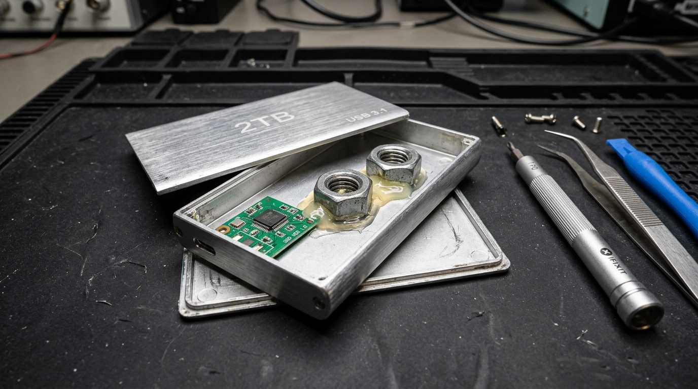

# 🛡️ FakeDriveShield - Storage Authenticity & Capacity Reclaimer

<p align="left">
  <a href="https://github.com/layanmoyura/fake-drive-detector/releases"></a>
  <a href="https://github.com/layanmoyura/fake-drive-detector/releases/latest"></a>
  <a href="https://github.com/layanmoyura/fake-drive-detector/blob/main/LICENSE"></a>
  
  
</p>

**FakeDriveShield** is an open-source, cross-platform diagnostic suite and desktop application designed to detect counterfeit / hacked-firmware storage drives (USB flash drives, SD cards, external SSDs). It visualizes memory integrity in real time with a **ValiDrive-style storage block canvas**, isolates phantom sectors to reclaim usable physical storage, and generates legally worded Markdown (`.md`) audit declarations for dispute resolution on Amazon, eBay, AliExpress, Temu, and PayPal.

<p align="center">
  
</p>

---

## ⚡ The Fake Drive Problem

Counterfeit storage devices have modified microcontroller firmware (e.g. MPTool, ChipsBank, Alcor) that deceptively reports a huge capacity (such as 2 TB or 1 TB) to the host operating system, when in reality only a low-capacity 8 GB – 32 GB flash die is present.

<p align="center">
  
</p>

When files written exceed the true physical memory size, the drive silently wraps around and overwrites earlier filesystem structures and user files without reporting I/O errors. Once unmounted or read back, all data past the physical threshold becomes permanently corrupted.

---

## 🌟 Key Features

### ⚡ Dual Verification Modes
* **⚡ Fast Smart Audit (~15–30 Seconds)**:
  - Writes a canary block at sector offset 0, followed by exponential boundary bisection across the drive's free space.
  - Instantly detects circular wrap-around overwriting without having to wait hours to write the entire drive.
  - Uses sub-millisecond pre-computed buffer generation (300× faster throughput).
* **🔍 Full Surface Scan**:
  - Performs comprehensive, linear block-by-block writes and SHA-256 integrity verifications across all available space for deep cell-wear analysis.

### 🧠 Non-Destructive Smart Free Space Allocation
* Automatically reads file system geometry and isolates existing user files from unallocated free space.
* Existing files on healthy, partially loaded drives are **preserved and never overwritten**.
* Bounded strictly to available free space to eliminate false-positive corruption alerts caused by disk-full (`WinError 112` / `ENOSPC`) conditions.

### 📊 ValiDrive-Style 256-Cell Storage Canvas (32×8 Grid)
Live visual feedback for every block of storage:
* 🟩 **Green (`#10B981`)**: Verified real physical storage (passes read-back & SHA-256 checks).
* 🟦 **Sky Blue (`#38BDF8`)**: Existing allocated user files (safely preserved).
* 🟥 **Red (`#EF4444`)**: Missing / phantom storage (wrap-around data loss or corrupt sectors).
* 🟨 **Yellow (`#F59E0B`)**: Active test block in progress.
* ⬛ **Dark Slate (`#334155`)**: Untested free storage.

### 🎯 Precision Heuristic Fraud Detection
* Identifies known factory MPTool counterfeit firmware signatures (`121220160204`, all-zero serials, ChipsBank, Alcor, Super Top).
* Smarter serial heuristics distinguish genuine OEM zero-padded serials (e.g. `AA00000000000489`) from fraudulent clone controllers.
* Flags abnormal 64 KB cluster sizes, missing volume serials, and suspicious bus geometry.
* Computes an instant **0–100% Fraud Risk Score**.

### 🛠️ Hardware Capacity Reclaimer
* Detects the highest contiguous safe physical boundary (e.g. 2 GB, 4 GB, 8 GB, 16 GB, 32 GB).
* Automatically re-partitions and formats the drive (via native Windows `diskpart` or cross-platform utilities) to lock out the ghost capacity permanently.
* Restores the drive to a stable, usable physical device that can no longer corrupt files.

### 📑 Publication-Ready Dispute Evidence Reports
* Exports detailed `.md` audit reports with drive telemetry, block status breakdowns, and timestamps.
* Includes an official **Consumer Dispute Declaration** formatted for one-click attachment to credit card chargeback requests or merchant dispute cases (Amazon, AliExpress, eBay, Temu, PayPal).

### 🖥️ Clean Desktop Experience & Zero CLI Popups
* Modern, responsive dark-themed GUI (`900x620`) with fixed aspect ratio to maintain pixel-perfect canvas alignment.
* Background system calls (PowerShell, diskpart, WMI) run silently with `CREATE_NO_WINDOW` and hidden process windows—no flashing terminal windows.
* Requires **zero external pip dependencies** (built purely on the Python 3 standard library).

---

## 🚀 How to Run

### Option 1: Standalone Windows Binary (`.exe`)
Download the pre-compiled standalone executable from the [GitHub Releases](https://github.com/layanmoyura/fake-drive-detector/releases/latest) page:
1. Download **`FakeDriveShield.exe`**.
2. Right-click and choose **Run as administrator** (required for drive geometry & partition reclaimer access).

### Option 2: 1-Click Batch Launcher (Windows)
Double-click **`Launch-GUI.bat`** in the repository root. It requests Administrator rights automatically and starts the Python app.

### Option 3: Terminal / Command Line (Windows, macOS, Linux)
Ensure Python 3.10+ is installed:

```bash
# Launch GUI Desktop App
python app.py

# Or use the Command-Line Interface (CLI):
python cli.py --list
python cli.py --inspect D

# Run Fast Smart Audit (~15-30 seconds, default)
python cli.py --test D --mode fast

# Run Full Surface Scan
python cli.py --test D --mode full

# Generate a dispute Markdown report
python cli.py --report D --output report.md
```

---

## 📁 Project Structure

```
fake-drive-detector/
├── .github/
│   └── workflows/
│       └── build-release.yml    # Automated CI/CD pipeline for standalone EXE releases
├── assets/
│   ├── fake_drive_scam.jpg      # Hardware scam anatomy and teardown illustration
│   └── ui_screenshot.png        # Screenshot of the modern Tkinter desktop interface
├── app.py                       # Modern desktop Tkinter GUI application
├── cli.py                       # Command-line interface with interactive test wizards
├── engine.py                    # Core testing engine: heuristic analysis, verification, reclaimer
├── FakeDriveShield.ps1          # Standalone native Windows PowerShell script
├── FakeDriveShield.spec         # PyInstaller build specification
├── Launch-GUI.bat               # 1-click elevated launcher for the Python application
├── Launch-FakeDriveShield.bat   # 1-click launcher for the PowerShell utility
├── LICENSE                      # MIT License
└── README.md                    # Project documentation and user guide
```

---

## ⚙️ Automated Releases (CI/CD)

Every time a release tag (e.g. `v1.0.1`) is pushed to GitHub, the `.github/workflows/build-release.yml` GitHub Actions pipeline automatically:
1. Checks out the repository.
2. Sets up Python 3.13.
3. Packages the project into a standalone single-file binary with PyInstaller.
4. Attaches `FakeDriveShield.exe` directly to the GitHub Release.

---

## ⚖️ License

This project is licensed under the **MIT License**. See the [LICENSE](LICENSE) file for details.
