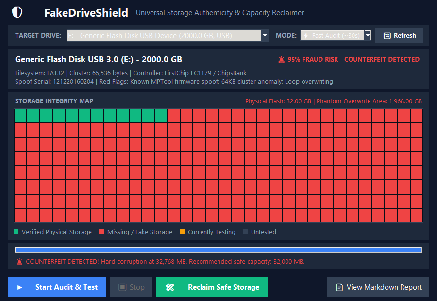

# 🛡️ FakeDriveShield - Storage Authenticity & Capacity Reclaimer

<p align="left">
  <a href="https://github.com/layanmoyura/fake-drive-detector/releases"></a>
  <a href="https://github.com/layanmoyura/fake-drive-detector/releases/latest"></a>
  <a href="https://github.com/layanmoyura/fake-drive-detector/blob/main/LICENSE"></a>
</p>

A cross-platform Python Desktop application that runs anywhere (Windows, macOS, Linux) with zero external pip dependencies. It detects counterfeit / fake-capacity storage drives, visually maps working vs corrupted memory cells (ValiDrive-style), re-partitions the drive to its safe physical size, and generates detailed Markdown (`.md`) audit reports.

<p align="center">
  
</p>

---

## 🌟 Features

* **Runs Anywhere**:
  - Uses Python's standard library (`tkinter`, `hashlib`, `threading`, `json`, `subprocess`).
  - **Zero pip packages required** (`pip install` not needed).
  - Cross-platform support for Windows, macOS, and Linux.

* **ValiDrive-Style Visual Storage Grid**:
  - 384-cell interactive canvas grid.
  - 🟩 **Green**: Validated real physical storage.
  - 🟥 **Red**: Missing / fake storage where data loss occurs.
  - 🟨 **Yellow**: In-progress test blocks.
  - ⬛ **Gray**: Untested storage.

* **Heuristic Fraud Detection**:
  - Identifies known counterfeit MPTool serial numbers (`121220160204`, `00000000`, Super Top, ChipsBank, Alcor).
  - Flags manipulated blank/`0x0` volume serials and 64 KB FAT32 cluster geometry.
  - Computes a 0–100% **Fraud Risk Score**.

* **Safe Hardware Reclaiming**:
  - Automatically isolates and locks out the phantom/fake sectors.
  - Creates a clean partition matching *only* the verified physical capacity (e.g. 1 GB, 16 GB).
  - Permanently eliminates silent file corruption and wrap-around overwriting.

* **Markdown (`.md`) Evidence Reports**:
  - Emits publication-ready Markdown audit files with tables, visual block bars, and test logs.
  - Includes a legal **Consumer Dispute Declaration** ready to attach to Amazon, eBay, AliExpress, Temu, or PayPal disputes.

---

## 🚀 How to Run

### Windows (1-Click Desktop Launcher)
Double-click **`FakeDriveShield-GUI.bat`** on your Desktop.

### Terminal / Command Line (Any OS: Windows, macOS, Linux)
```bash
# Launch GUI Desktop App
python app.py

# Or use the CLI version
python cli.py --list
python cli.py --inspect D
python cli.py --test D
```

---

## 📁 Project Structure

```
fake-drive-detector/
├── app.py                  # Cross-platform Tkinter Desktop GUI application
├── engine.py               # Cross-platform diagnostic, testing & report engine
├── cli.py                  # Command-line interface and terminal wizard
├── FakeDriveShield.ps1     # Native Windows PowerShell script
├── Launch-GUI.bat          # 1-click elevated launcher for the Python GUI
├── Launch-FakeDriveShield.bat # 1-click launcher for the PowerShell tool
└── README.md               # User guide and technical documentation
```
